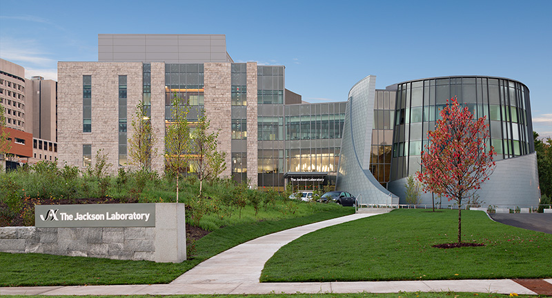

# Contact

Peter Robinson
 
* Professor, Jackson Laboratory for Genomic medicine (JAX)
* Donald A. Roux Chair, Genomics and Computational Biology, JAX (2017-2023)
* Professor for Medical Computational Science, Berlin Institute of Health (2024-)
* Director,  [Human Phenotype Ontology Consortium](https://hpo.jax.org/app/)
* Co-Program Director, [Monarch Initiative](http://monarchinitiative.org)
* [email](mailto:peter.robinson@jax.org)

<figure markdown>
{ width="400" }
<figcaption>Peter Robinson
</figcaption>
</figure>

The Robinson Lab started at the [Charité – Universitätsmedizin Berlin](https://www.charite.de/) and moved to the 
[Jackson Laboratory (JAX) for Genomic Medicine](https://www.jax.org/) in 2016.
In January 2024, we moved to the [Berlin Institute of Health](https://www.bihealth.org/en/) (BIH) at Charité in Berlin.
In the framework of an [Alexander von Humboldt Professorship](https://www.humboldt-foundation.de/entdecken/newsroom/dossier-alexander-von-humboldt-professur/peter-nicholas-robinson), retaining a lab at JAX.

## Berlin Institute of Health

The Robinson Lab is located in the fifth floor of the Berlin Institute of Health (BIH) in the 
Rahel Hirsch Center for Translational Medicine of the Charité in Berlin Mitte (Luisenstraße 65, 10117 Berlin).

<figure markdown>
{ width="400" }
<figcaption>Berlin Institute of Health
</figcaption>
</figure>

## The Jackson Laboratory for Genomic Medicine

The Robinson Lab is also located at the Jackson Laboratory (JAX) in the
for Genomic Medicine (JAX-GM) campus in Farmington Connecticut. 
The primary location of the Robinson lab from 2016-2023 was at JAX-GM and we are delighted to keep the affiliation.

<figure markdown>
{ width="400" }
<figcaption>The Jackson Laboratory for Genomic Medicine
</figcaption>
</figure>

