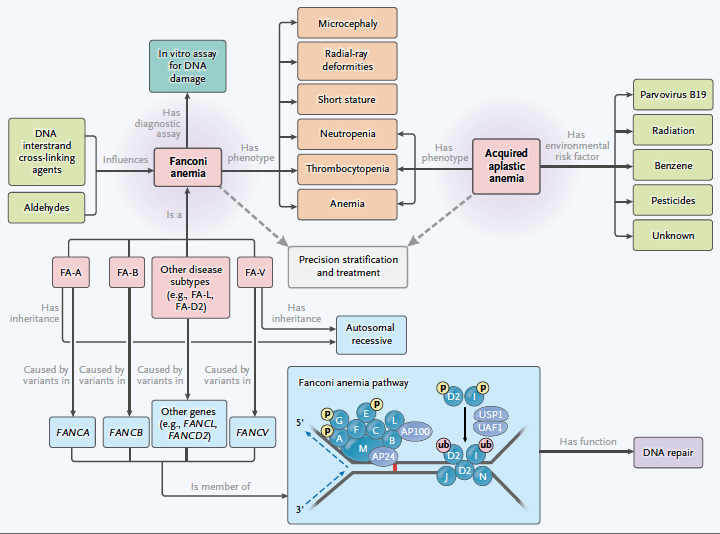
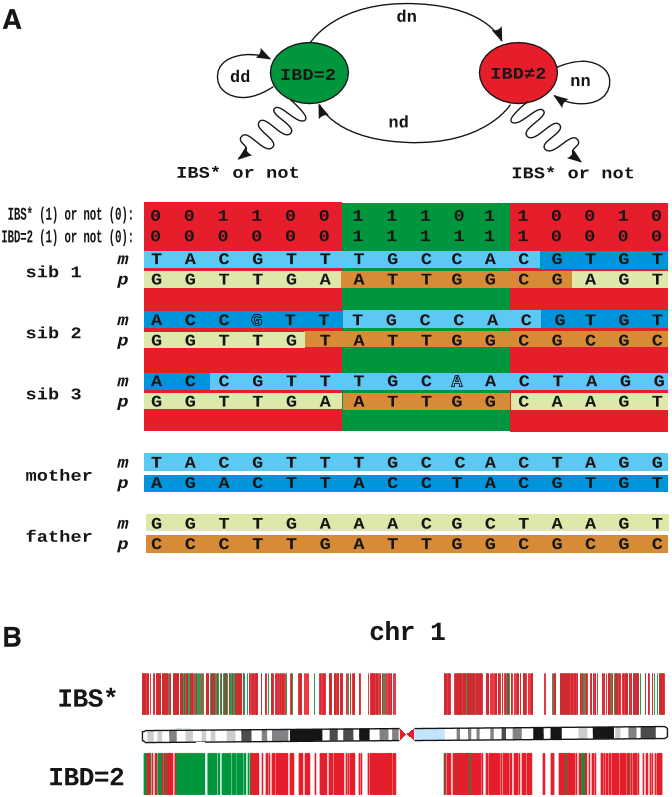

# The Robinson Lab

Our lab is made up of bioinformaticians, computer scientists, ontologists, curators, and software engineers.
Our mission is to develop software resources and algorithms to improve human health.
Our research focuses on the development of ontologies and software for translational genomics.

- **Human Phenotype Ontology** – standardized vocabulary for phenotypic abnormalities  
  [:octicons-arrow-right-24: Visit](http://www.human-phenotype-ontology.org)

- **Phenopacket Schema** – GA4GH standard for clinical data  
  [:octicons-arrow-right-24: Learn more](https://pubmed.ncbi.nlm.nih.gov/35705716/)

- **Software** – Algorithms and tools for ontology-based translational bioinformatics and for genomics analysis  
  [:octicons-arrow-right-24: Software](software.md)

  - **Teaching** – Winter semester: Ontologies and LLMs  
  [:octicons-arrow-right-24: Teaching](teaching.md)

## Latest news

--8<-- "snippets/news_teaser.md"

## Research

We have a focus on ontologies, which are an important kind of computational knowledge 
representation, a field of artificial intelligence that represents domain knowledge in a form that 
computer algorithms can leverage to perform complex tasks. We develop algorithms 
that leverage ontologies, statistical, semantic, Bayesian, and machine-learning methologies in innovative ways 
to address challenges in rare-disease and precision medicine. The focus of the research is both on the 
development of new AI algorithms and their application to medical data. 

### Ontologies

A major focus of the lab is to create ontologies for representing and analyzing medical data. Ontologies allow clinical data to be modeled computationally in a way that enables differential diagnostic support and machine learning.

<figure markdown>
{ width="500" }
<figcaption>Ontology-Driven Representation of Clinical Data. Taken from Haendel MA, Chute CG, Robinson PN. Classification, Ontology, and Precision Medicine. N Engl J Med. 2018 Oct 11;379(15):1452-1462.
</figcaption>
</figure>

Our group has created the [Human Phenotype Ontology](http:///www.human-phenotype-ontology.org) and the [Medical Action Ontology](https://pubmed.ncbi.nlm.nih.gov/37503136/) and has led the development of the [Phenopacket Schema](https://pubmed.ncbi.nlm.nih.gov/35705716/) for the [Global Alliance for Genomics and Health](https://www.ga4gh.org/). Our work is performed as part of the [Monarch Initiative](http://monarchinitiative.org), and international team of ontologiests and bioinformaticians dedicated to applying ontologies and semantic algorithms to improve human health.

### Translational and Genomic Bioinformatics

Our group creates algorithms for translational and genomic research. Topics include diagnostic exome and genome sequencing, analysis of genomic data from RNA-seq, ChIP-seq, and Hi-C, and machine learning.
Although our focus has been
on rare genetic disease, current projects involve common diseases and cancer.

<figure markdown>
{ width="400" }
<figcaption>Krawitz, P. M., et al. (2010). Identity-by-descent filtering of exome sequence data identifies PIGV mutations in hyperphosphatasia mental retardation syndrome. Nat. Genet. 42:827–829.
</figcaption>
</figure>