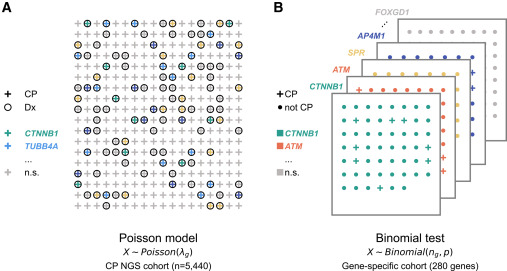

# News

## 2026

**2026-11-21 – Cerebral Palsy May Not Be What Scientists Thought It Was**

Commentary on 'phenotypic paradigm' article published in SciTechDaily [More](https://scitechdaily.com/cerebral-palsy-may-not-be-what-scientists-thought-it-was/){:target="_blank"}

**2026-11-19 – Human Phenotype Ontology, GA4GH PhenopacketSchema and Phenotype-Driven AI**

P. Robinson, talk at Biomedical Ontologies and Standards: Integrating Clinical and Genetic Data for Research-Ready Cohorts, Institut Pasteur, Paris, France

**2026-09-03 – A phenotypic paradigm for cerebral palsy genetics**

{ width="300" align=right }

Article published in American Journal of Human Genetics [More](https://pubmed.ncbi.nlm.nih.gov/41646824/){:target="_blank"}

