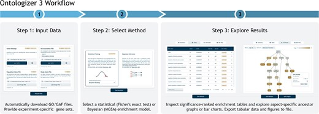

# News

## 2026

**2026-11-21 – Cerebral Palsy May Not Be What Scientists Thought It Was**

Commentary on 'phenotypic paradigm' article published in SciTechDaily [More](https://scitechdaily.com/cerebral-palsy-may-not-be-what-scientists-thought-it-was/){:target="_blank"}

**2026-11-19 – Human Phenotype Ontology, GA4GH PhenopacketSchema and Phenotype-Driven AI**

P. Robinson, talk at Biomedical Ontologies and Standards: Integrating Clinical and Genetic Data for Research-Ready Cohorts, Institut Pasteur, Paris, France

**2026-11-03 – Ontologizer 3: a cross-platform desktop application for frequentist and Bayesian GO enrichment analysis**

{ width="300" align=right }

Article published in NAR Genomics and Bioinformatics [More](https://pubmed.ncbi.nlm.nih.gov/42979155/){:target="_blank"}

**2026-10-31 – Vom Genom zur Therapie: Computational Biology und die Personalisierung
der Medizin**

P.Robinson, Talk at 99. Versammlung des Vereins Rhein-Mainischer Augenärzte e.V., Fulda, Germany

**2026-09-03 – A phenotypic paradigm for cerebral palsy genetics**

{ width="300" align=right }

Article published in American Journal of Human Genetics [More](https://pubmed.ncbi.nlm.nih.gov/41646824/){:target="_blank"}

**2026-05-16 – HPO workshop for revising and extending the HPO for anesthesia-related phenotypes.**

P. Robinson, Workshop with the European Malignant Hyperthermia Group (EMHG), Basel, Switzerland [More](https://www.emhg.org){:target="_blank"}

**2026-05-04 – Phenotype Ontology: Standards & Interoperabilität**

P. Robinson, Seminar for students in Curriculum for Fostering Medical Interest and Interdisciplinary Networking(CUMIN) [More](https://www.uni-bielefeld.de/zwe/citec/research/projects/cumin/){:target="_blank"}

**2026-04-12 – HPO workshop with the European Reference Network EYE**

P. Robinson, ERN-EYE workshop, Helsinki, Finland [More](https://www.ern-eye.eu/de/){:target="_blank"}

**2026-01-16 – Deep Phenotyping, and AI for Computational Precision Medicine**

P. Robinson, talk at the 291st European Neuromuscular Center (ENMC) International Workshop, Optimizing collaborative models in
neuromuscular diseases: the role of ontologies and artificial intelligence for enhanced data insights [More](https://www.enmc.org){:target="_blank"}

## 2025

**2025-11-13 – Herman Van Den Berghe lecture (award)**

P. Robinson, Herman Van Den Berghe award, Leuven Belgium. [More](https://gbiomed.kuleuven.be/english/cme/about/herman-vanden-berghe){:target="_blank"}

